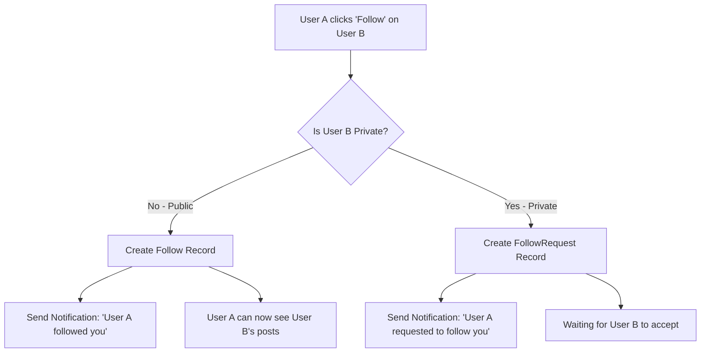
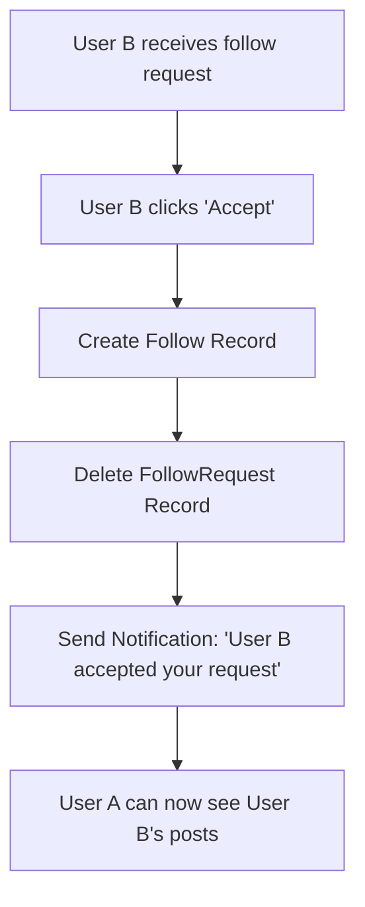
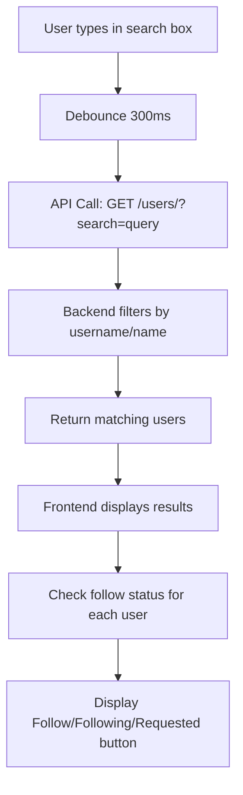
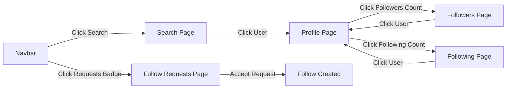

# Followers and Following System - Complete Workflow

## Overview
This document describes the complete implementation of the Instagram-like followers, following, and search system with support for **private accounts** and **follow requests**.

---

## 📋 Table of Contents
1. [Backend Implementation](#backend-implementation)
2. [Frontend Implementation](#frontend-implementation)
3. [User Workflows](#user-workflows)
4. [Privacy & Access Control](#privacy--access-control)
5. [API Reference](#api-reference)

---

## 🔧 Backend Implementation

### Database Models

#### 1. **User Model** (`backend/api/models.py`)
```python
class User(AbstractUser):
    is_private = models.BooleanField(default=True)  # Private by default
    
    @property
    def followers_count(self):
        """Returns the number of users following this user."""
        return self.followers.count()
    
    @property
    def following_count(self):
        """Returns the number of users this user is following."""
        return self.following.count()
```

#### 2. **Follow Model**
```python
class Follow(models.Model):
    follower = models.ForeignKey(User, related_name='following', on_delete=models.CASCADE)
    followed = models.ForeignKey(User, related_name='followers', on_delete=models.CASCADE)
    created_at = models.DateTimeField(auto_now_add=True)
    
    class Meta:
        unique_together = ['follower', 'followed']  # Prevent duplicate follows
        ordering = ['-created_at']
```

#### 3. **FollowRequest Model**
```python
class FollowRequest(models.Model):
    requester = models.ForeignKey(User, related_name='sent_requests', on_delete=models.CASCADE)
    recipient = models.ForeignKey(User, related_name='received_requests', on_delete=models.CASCADE)
    created_at = models.DateTimeField(auto_now_add=True)
    
    class Meta:
        unique_together = ['requester', 'recipient']  # One request per pair
```

---

## 🎯 API Endpoints

### Follow System Routes (`backend/api/urls.py`)

| Endpoint | Method | Auth | Description |
|----------|--------|------|-------------|
| `/users/` | GET | ✅ | Search users by username |
| `/users/<user_id>/` | GET | ✅ | Get user profile details |
| `/users/<user_id>/follow/` | POST | ✅ | Follow user or send request |
| `/users/<user_id>/unfollow/` | POST | ✅ | Unfollow or cancel request |
| `/users/<user_id>/followers/` | GET | ✅ | Get user's followers list |
| `/users/<user_id>/following/` | GET | ✅ | Get user's following list |
| `/users/<user_id>/follow-status/` | GET | ✅ | Check follow status |
| `/users/<user_id>/posts/` | GET | ✅ | Get user's posts |
| `/follow-requests/pending/` | GET | ✅ | Get pending follow requests |
| `/follow-requests/accept/<requester_id>/` | POST | ✅ | Accept follow request |
| `/follow-requests/reject/<requester_id>/` | POST | ✅ | Reject follow request |

---

## 🔄 User Workflows

### 1️⃣ **Following a User**



**Code Flow:**
```python
# FollowUserView in backend/api/views.py
if to_follow.is_private:
    # Private account - send follow request
    FollowRequest.objects.create(requester=request.user, recipient=to_follow)
    Notification.objects.create(
        recipient=to_follow,
        actor=request.user,
        notification_type='follow_request',
        message=f'{request.user.username} wants to follow you'
    )
    return Response({'detail': 'Follow request sent'})
else:
    # Public account - follow immediately
    Follow.objects.create(follower=request.user, followed=to_follow)
    Notification.objects.create(
        recipient=to_follow,
        actor=request.user,
        notification_type='follow_accept',
        message=f'{request.user.username} started following you'
    )
    return Response({'followed': True})
```

---

### 2️⃣ **Accepting Follow Request**



**Code Flow:**
```python
# AcceptFollowRequestView in backend/api/views.py
Follow.objects.create(follower=requester, followed=request.user)
req.delete()  # Remove the follow request
Notification.objects.create(
    recipient=requester,
    actor=request.user,
    notification_type='follow_accept',
    message=f'{request.user.username} accepted your follow request'
)
```

---

### 3️⃣ **Searching for Users**



**Frontend Code:**
```typescript
// Debounced search in Search.tsx
useEffect(() => {
  const searchUsers = async () => {
    if (searchQuery.trim().length < 2) return;
    
    const response = await apiService.searchUsers(searchQuery.trim());
    setSearchResults(response.data);
    
    // Fetch follow status for each user
    const statusMap: Record<number, string> = {};
    await Promise.all(
      response.data.map(async (user) => {
        const statusResponse = await apiService.checkFollowStatus(user.id);
        statusMap[user.id] = statusResponse.data.status;
      })
    );
    setFollowingStatus(statusMap);
  };
  
  const debounceTimer = setTimeout(searchUsers, 300);
  return () => clearTimeout(debounceTimer);
}, [searchQuery]);
```

---

## 🔒 Privacy & Access Control

### Post Visibility Rules

| Scenario | Can View Posts? | Can View Followers/Following? |
|----------|----------------|-------------------------------|
| Own Profile | ✅ Yes | ✅ Yes |
| Public Profile | ✅ Yes | ✅ Yes |
| Private + Following | ✅ Yes | ✅ Yes |
| Private + Not Following | ❌ No | ❌ No |
| Private + Request Pending | ❌ No | ❌ No |

**Backend Implementation:**
```python
# UserPostsListView in backend/api/views.py
def get_queryset(self):
    user = User.objects.get(id=user_id)
    
    # Allow users to see their own posts
    if user == self.request.user:
        return Post.objects.filter(user_id=user_id)
    
    # Check privacy settings for other users
    if user.is_private and not Follow.objects.filter(
        follower=self.request.user, 
        followed=user
    ).exists():
        return Post.objects.none()  # Return empty queryset
    
    return Post.objects.filter(user_id=user_id)
```

---

## 🎨 Frontend Implementation

### Key Components

#### 1. **Search Page** (`src/pages/Search.tsx`)
- Real-time user search with 300ms debounce
- Display search results with follow buttons
- Recent searches stored in localStorage
- Follow status indicators (Following/Requested/Follow)

#### 2. **Profile Page** (`src/pages/Profile.tsx`)
- Display user info, posts, followers, following counts
- Follow/Unfollow/Request button
- Privacy-aware post visibility
- Clickable followers/following counts → navigate to lists

#### 3. **Followers Page** (`src/pages/Followers.tsx`)
- List all followers of a user
- Follow buttons for each follower
- Privacy-aware (only visible if allowed)

#### 4. **Following Page** (`src/pages/Following.tsx`)
- List all users a user is following
- Unfollow buttons
- Privacy-aware

#### 5. **Follow Requests Page** (`src/pages/FollowRequests.tsx`)
- List pending follow requests
- Accept/Reject buttons
- Real-time count badge in navbar

---

## 📱 Frontend Features

### Follow Status States
```typescript
type FollowStatus = 'following' | 'requested' | 'not_following' | 'self';
```

- **`following`**: User is already following the target user
- **`requested`**: Follow request sent (waiting for approval)
- **`not_following`**: No relationship
- **`self`**: Viewing own profile

### Button States
| Status | Button Text | Button Style | Action |
|--------|-------------|--------------|--------|
| `following` | "Following" | Outline (gray) | Unfollow |
| `requested` | "Requested" | Outline (gray) | Cancel Request |
| `not_following` | "Follow" | Solid (blue) | Follow/Request |
| `self` | - | Hidden | - |

---

## 🔔 Notifications

### Notification Types
1. **`follow_request`**: Someone requested to follow you (private account)
2. **`follow_accept`**: 
   - Someone followed you (public account)
   - Someone accepted your follow request

**Notification Creation:**
```python
Notification.objects.create(
    recipient=target_user,
    actor=current_user,
    notification_type='follow_request',  # or 'follow_accept'
    message=f'{current_user.username} wants to follow you'
)
```

---

## 🚀 Frontend Routes

| Route | Component | Description |
|-------|-----------|-------------|
| `/search` | Search | Search users by username |
| `/profile/:username` | Profile | View user profile |
| `/followers/:userId` | Followers | View user's followers |
| `/following/:userId` | Following | View user's following |
| `/follow-requests` | FollowRequests | Manage follow requests |

---

## 🔗 Navigation Flow



---

## 🛠️ Implementation Details

### API Service Methods (`src/services/api.ts`)

```typescript
// Search users
async searchUsers(query: string): Promise<AxiosResponse<User[]>>

// Follow operations
async followUser(userId: number): Promise<AxiosResponse<{ detail?: string; followed?: boolean }>>
async unfollowUser(userId: number): Promise<AxiosResponse<{ detail: string }>>

// Get lists
async getFollowers(userId: number): Promise<AxiosResponse<User[]>>
async getFollowing(userId: number): Promise<AxiosResponse<User[]>>

// Follow status
async checkFollowStatus(userId: number): Promise<AxiosResponse<{ status: string }>>

// Follow requests
async getPendingFollowRequests(): Promise<AxiosResponse<FollowRequest[]>>
async acceptFollowRequest(requesterId: number): Promise<AxiosResponse<{ detail: string }>>
async rejectFollowRequest(requesterId: number): Promise<AxiosResponse<{ detail: string }>>
```

---

## 🎯 Key Features

### ✅ Implemented Features

1. **User Search**
   - Real-time search with debouncing
   - Search by username, first name, last name
   - Recent searches saved locally
   - Follow buttons in search results

2. **Follow System**
   - Public accounts: Instant follow
   - Private accounts: Request-based follow
   - Follow/Unfollow functionality
   - Follow status tracking

3. **Follow Requests**
   - Send follow requests to private accounts
   - Accept/Reject requests
   - Real-time request count badge
   - Notifications for requests

4. **Privacy Control**
   - Private/Public account toggle
   - Privacy-aware post visibility
   - Privacy-aware followers/following lists

5. **User Interface**
   - Clean, Instagram-like design
   - Responsive layout
   - Loading states
   - Error handling
   - Toast notifications

---

## 📊 State Management

### Follow Status Tracking
```typescript
const [followStatus, setFollowStatus] = useState<'following' | 'requested' | 'not_following' | 'self'>('not_following');
```

### Follow Counts
```typescript
const [followersCount, setFollowersCount] = useState(0);
const [followingCount, setFollowingCount] = useState(0);
```

### Real-time Updates
- Counts update immediately on follow/unfollow
- Follow status updates after API response
- Notifications trigger UI updates

---

## 🧪 Testing Workflow

### Manual Testing Steps

1. **Search Functionality**
   - Navigate to `/search`
   - Type username in search box
   - Verify results appear with 300ms debounce
   - Click on user → verify navigation to profile

2. **Follow Public User**
   - Search for public user
   - Click "Follow" button
   - Verify button changes to "Following"
   - Verify followers count increases

3. **Follow Private User**
   - Search for private user
   - Click "Follow" button
   - Verify button changes to "Requested"
   - Verify notification sent to target user

4. **Accept Follow Request**
   - Navigate to `/follow-requests`
   - Click "Accept" on a request
   - Verify follower appears in followers list
   - Verify requester receives notification

5. **View Followers/Following**
   - Navigate to profile
   - Click followers count → verify list appears
   - Click following count → verify list appears
   - Verify follow buttons work in lists

---

## 🎨 UI/UX Highlights

### Search Page
- Clean search bar with icon
- Debounced input for performance
- Recent searches section
- Empty state with helpful message
- User cards with profile pics, bio, stats

### Profile Page
- Clickable follower/following counts
- Context-aware follow button
- Privacy message for private accounts
- Smooth transitions and animations

### Followers/Following Pages
- Back button for navigation
- User list with follow buttons
- Empty states
- Loading indicators

### Follow Requests Page
- Accept/Reject buttons
- Request timestamp
- Request count badge in navbar
- Auto-refresh every 30 seconds

---

## 🔮 Future Enhancements

1. **Advanced Search**
   - Filter by bio content
   - Sort by followers/following count
   - Search suggestions

2. **Mutual Friends**
   - Show mutual followers
   - "Suggested for you" section

3. **Block/Mute**
   - Block users
   - Mute users
   - Report functionality

4. **Analytics**
   - Follow/Unfollow trends
   - Profile view statistics
   - Engagement metrics

---

## 📝 Summary

This implementation provides a complete Instagram-like follow system with:
- ✅ User search functionality
- ✅ Follow/Unfollow with private account support
- ✅ Follow request management
- ✅ Privacy-aware content visibility
- ✅ Real-time notifications
- ✅ Responsive UI with proper error handling

All components are fully integrated with the Django backend and follow modern React best practices with TypeScript, proper state management, and excellent UX.
